# bilibili

一个支持 iOS 27 液态玻璃（Liquid Glass）的第三方哔哩哔哩 iOS 客户端，基于 SwiftUI + Xcode 27 / iOS 27 SDK。**iPhone 与 iPad 通用**，最低 iOS 17.0（旧系统上液态玻璃自动降级为自绘近似）。

当前功能：首页四流（推荐/关注/热门/直播，**上滑自动折叠顶栏 + 悬浮玻璃底栏**）、搜索、**关注动态时间线**、观看历史（**支持断点续播**）、收藏夹、视频详情页与全屏播放、弹幕浮动层（**支持不透明度与显示区域设置**）、倍速播放、**点赞/投币/收藏**（**长按点赞一键三连**）、**视频评论区（回复 / 点赞 / 进发言人主页）**、**UP 主个人主页与投稿列表**、**我的主页（资料 / 账号属性 / 历史 / 收藏 / 点赞）**、**直播间实时弹幕与全屏**、扫码登录与会话持久化。App 图标提供常规 / 深色 / 着色三套变体，界面支持**跟随系统 / 白天 / 夜间**三种外观，主屏图标**长按/重按**可直达搜索与热门。

## 功能总览

| 模块 | 功能点 |
| --- | --- |
| 首页 | 推荐 / 关注 / 热门 / 直播四流，左右滑动切换；上滑自动折叠顶栏，搜索框缩成图标；悬浮玻璃底栏，内容从底下穿过 |
| 搜索 | 热搜词 + 综合搜索，WBI 签名；结果双列瀑布流，点击进详情 |
| 视频播放 | AVPlayer 硬解（VideoToolbox），断点续播（服务端历史 + 本地记录双保险），倍速播放（0.5x ~ 2.0x），**画中画小窗（手动按钮 / 退后台自动进入）**；**±10 秒快进回退 + 胶囊玻璃播放条**，**长按播放区 2× 加速**（松手回到原倍速） |
| 弹幕 | 滚动 / 顶部 / 底部弹幕，轨道防重叠调度；不透明度与显示区域（全屏 / 上半区 / 下半区）设置；直播实时弹幕（WebSocket） |
| 互动 | 点赞 / 投币 / 收藏；**长按点赞一键三连**（带扇形散开动效与触觉反馈） |
| 评论区 | 一级评论 + 楼中楼懒加载、点赞、回复、排序切换，可从发言人进入其主页 |
| 社区 | 关注 UP 主动态时间线（图文 + 转发）、UP 主个人主页与投稿列表、我的主页（资料 / 账号属性 / 历史 / 收藏 / 点赞 / 收藏夹管理） |
| 直播 | 直播间列表、拉流播放、实时弹幕、手动 / 转屏全屏 |
| 账号 | 扫码登录，Cookie 会话持久化，冷启动自动恢复登录态 |
| 手势 | 所有被推入的页面支持**左滑返回**（导航栏隐藏后系统手势被禁用，已修复）；播放区**长按加速**，全屏时**左半屏竖滑调亮度 / 右半屏竖滑调音量** |
| 外观 | 近黑画布 + 品牌色极光底、封面即卡片的大圆角视觉（参考 Apple TV）；液态玻璃（iOS 26+ `glassEffect` + 自绘光学边缘）；**全局点按外围浮出椭圆液态玻璃**（跟随控件形状）；跟随系统 / 白天 / 夜间三种模式，明暗双套 App 图标 |
| 快捷入口 | 主屏图标**重按（3D Touch）/ 长按（Haptic Touch）**弹出快捷菜单：**搜索**、**热门视频**两条直达，冷启动与后台唤起都能落地 |
| 多设备 | **iPhone / iPad 通用**（`TARGETED_DEVICE_FAMILY = 1,2`）；iPad 上封面网格 4 列、底栏与正文限宽居中；最低 **iOS 17.0**，iOS 26 以下液态玻璃自动降级为自绘近似 |

## 示意图

**浏览与播放**

| 首页 | 顶栏收起 | 详情 + 评论区 | 全屏播放 |
| --- | --- | --- | --- |
| 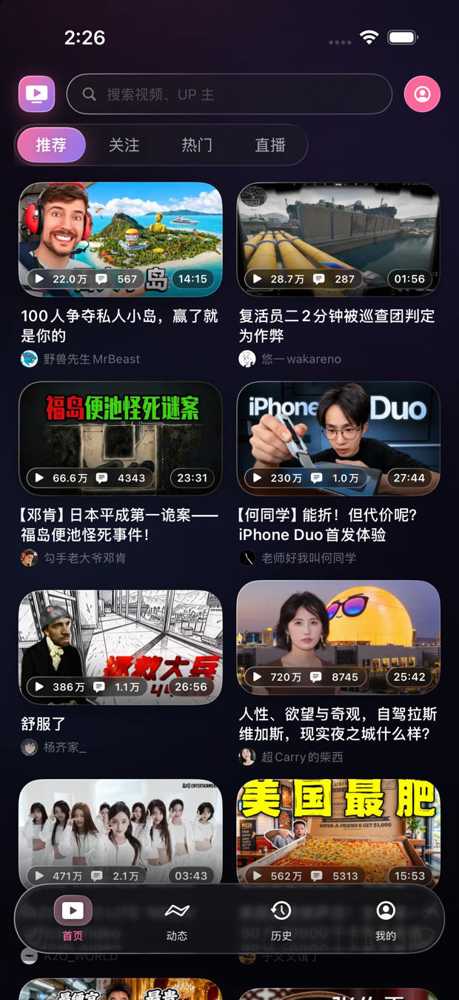 | 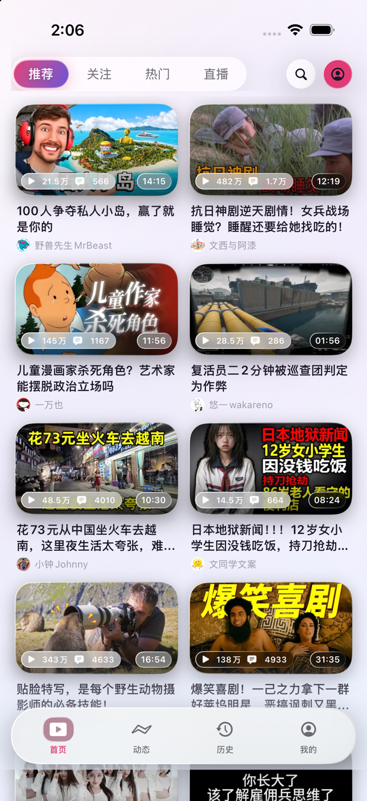 | 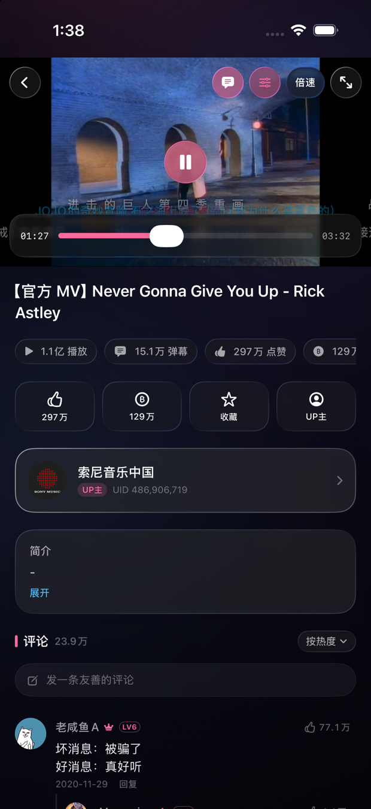 | 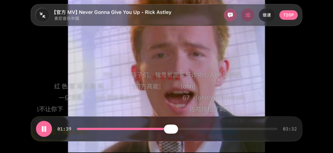 |

| 播放器 + 弹幕 | 搜索 | 动态时间线 | UP 主主页 |
| --- | --- | --- | --- |
| 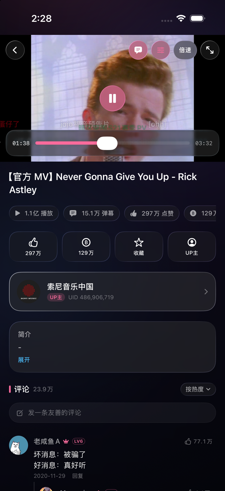 | 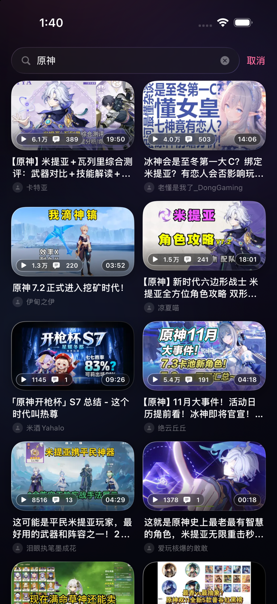 | 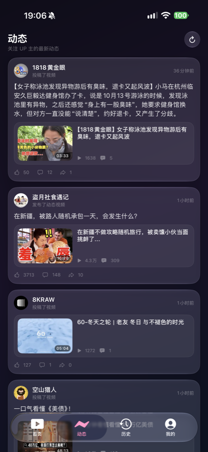 | 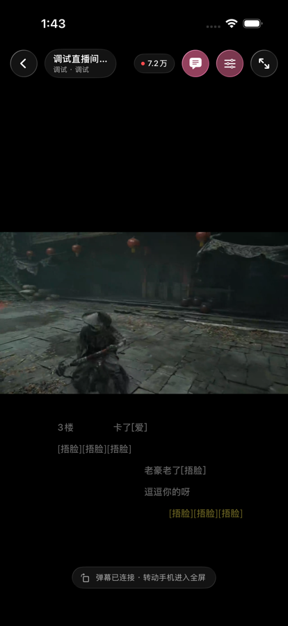 |

**播放器控件与手势**（竖屏 / 全屏的胶囊播放条与中央 ±10 秒；手势气泡用 `-debugHUD` 常显，真实场景松手即消失）

| 竖屏播放器 | 全屏播放器 | 亮度气泡 | 长按加速气泡 |
| --- | --- | --- | --- |
| 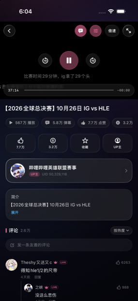 | 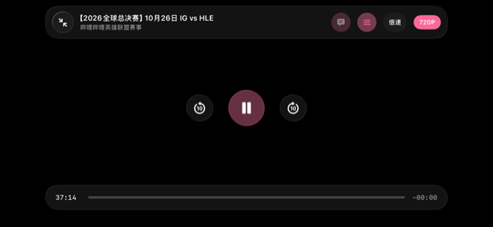 | 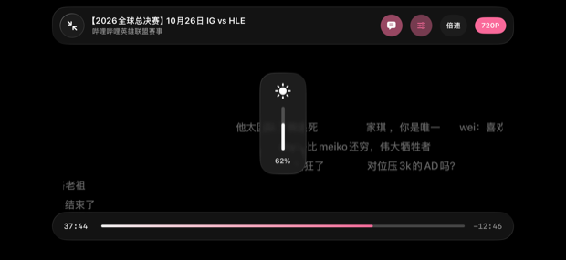 | 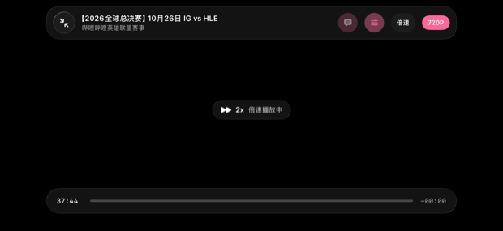 |

**直播**

| 直播列表 | 实时弹幕 | 直播全屏 |
| --- | --- | --- |
| 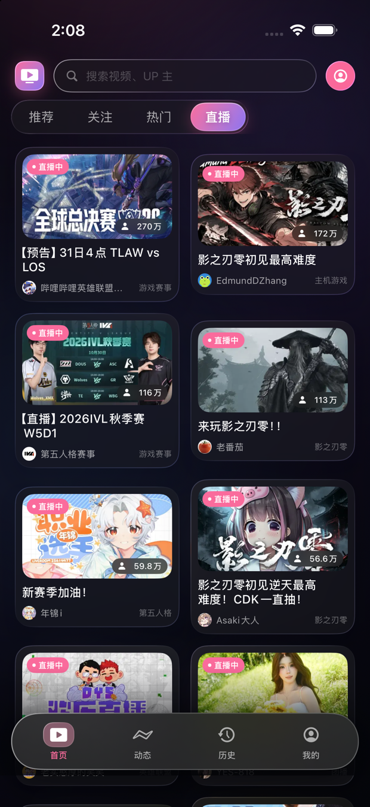 | 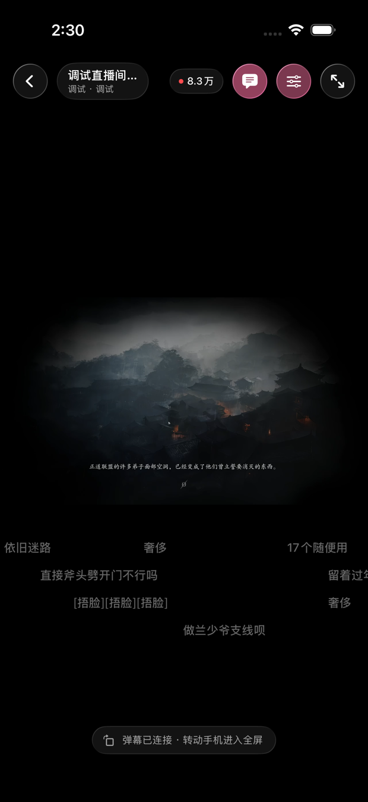 | 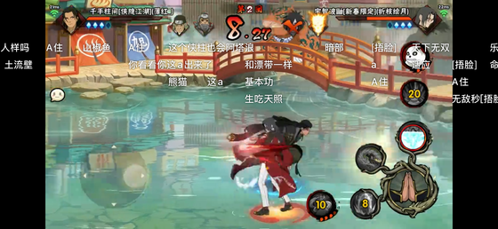 |

**我的主页与登录**

| 我的主页 | 扫码登录 | App 图标 |
| --- | --- | --- |
| 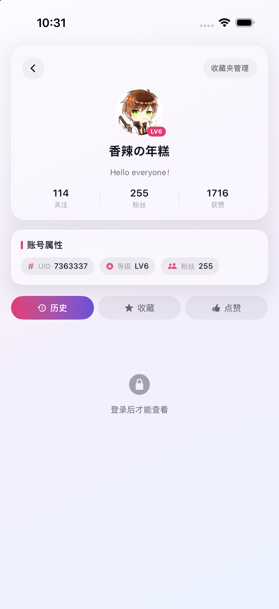 |  | 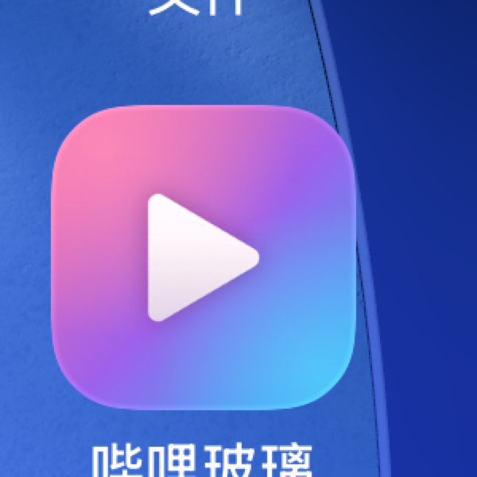 |

**浅色外观**

| 首页 | 详情 | 我的主页 | 顶栏收起（深色） |
| --- | --- | --- | --- |
| 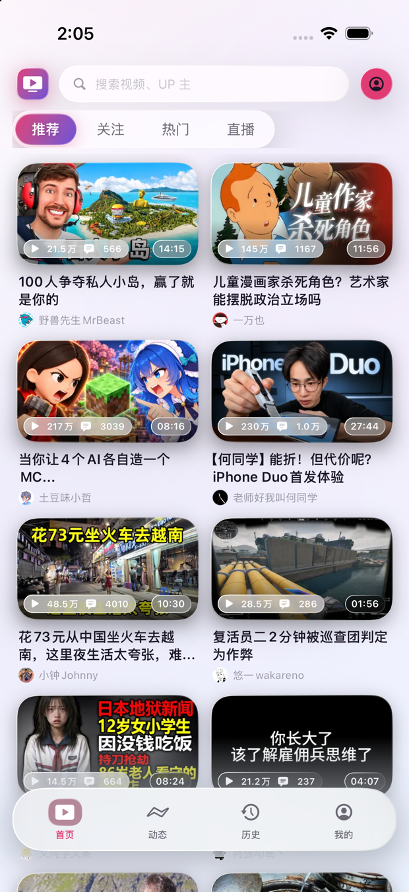 | 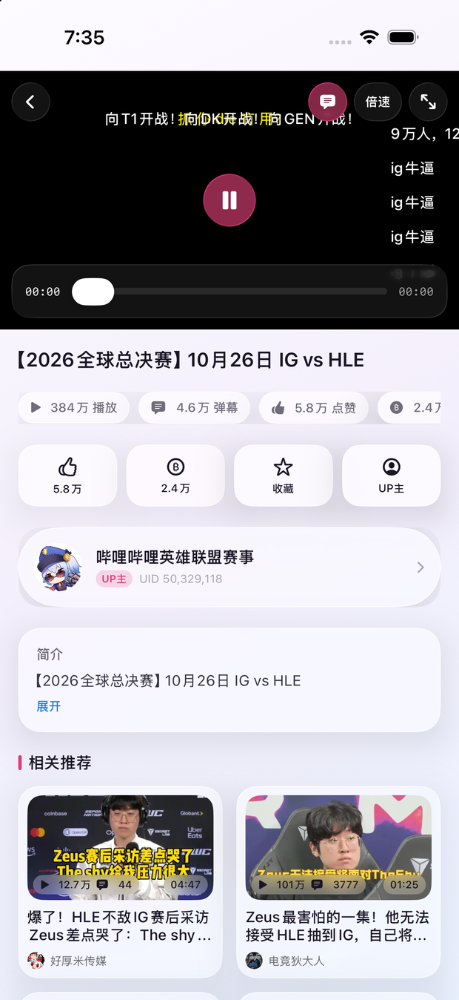 | 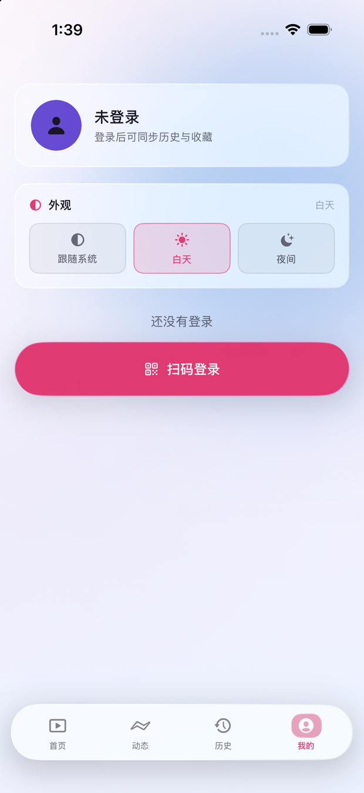 | 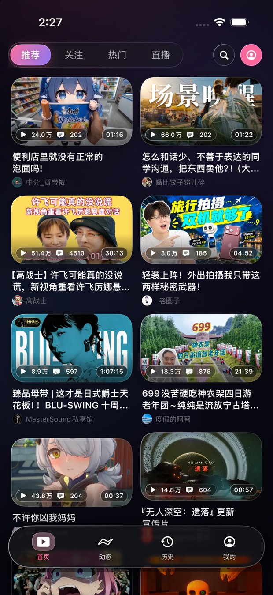 |

**点按反馈**（用 `-debugPressPreview` 让所有按钮常显按下态，展示外扩的椭圆液态玻璃）

| 深色 · 我的 | 浅色 · 首页 |
| --- | --- |
| 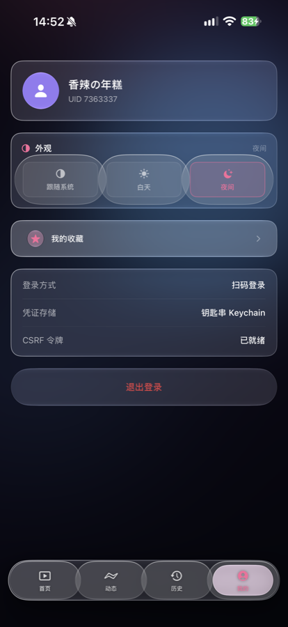 | 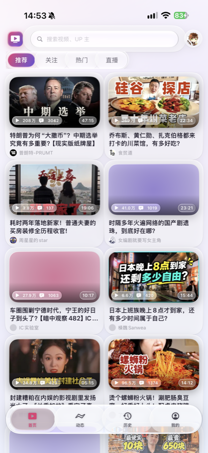 |

## 运行

```bash
cd BiliGlass
xcodegen generate          # 如首次拉取，需重新生成工程
open BiliGlass.xcodeproj   # Xcode 27 打开后直接 Run
```

也可以用命令行构建到模拟器：

```bash
xcodebuild -project BiliGlass.xcodeproj -scheme BiliGlass \
  -destination 'id=<模拟器 UDID>' -configuration Debug \
  CODE_SIGNING_ALLOWED=NO build
```

### 安装到真机

真机安装需要签名，工程已配置为自动签名（Team `4486C55NWW` / Tao Jiang Personal Team）。

**首次使用必须先登录 Apple ID**，否则构建会报 `No Accounts`——免费个人团队的 provisioning profile 只能由已登录的 Xcode 生成，无法从命令行代劳：

1. Xcode → Settings（⌘,）→ Accounts → 左下角「+」→ 登录 `taojt08@icloud.com`
2. iPhone 解锁后拔插数据线，弹窗点「信任」
3. iPhone → 设置 → 隐私与安全性 → **开发者模式** → 打开并重启

完成后一条命令搞定（自动探测设备、编译、签名、安装、启动）：

```bash
./install-device.sh
```

也可以指定设备：

```bash
./install-device.sh 00008140-001878511A39801C
```

首次打开若提示「不受信任的开发者」：iPhone → 设置 → 通用 → VPN 与设备管理 → 信任对应账号。

> 个人免费团队的签名**有效期只有 7 天**，到期后 App 会闪退，重新运行脚本即可续签。

### 调试参数

模拟器里没法脚本化点击，因此留了一组只读 UserDefaults 的直达入口（正式使用时不设置这些键即可）：

```bash
UDID=<模拟器 UDID>
APP=com.biliglass.app
xcrun simctl spawn $UDID defaults write $APP debugTab     -int 2        # 0 首页 / 1 动态 / 2 历史 / 3 我的
xcrun simctl spawn $UDID defaults write $APP debugSegment -int 3        # 0 推荐 / 1 关注 / 2 热门 / 3 直播
xcrun simctl spawn $UDID defaults write $APP debugBVID -string BV19wnQ6sExk   # 直达视频详情
xcrun simctl spawn $UDID defaults write $APP debugMid  -int 946974            # 直达 UP 主主页
xcrun simctl spawn $UDID defaults write $APP debugFullscreen -bool YES        # 详情页自动进全屏
xcrun simctl spawn $UDID defaults write $APP debugSearch -bool YES            # 直达搜索页
xcrun simctl spawn $UDID defaults write $APP debugKeyword -string "影之刃零"   # 预填搜索词并自动搜索
xcrun simctl spawn $UDID defaults write $APP debugRate -float 2.0             # 指定倍速
xcrun simctl spawn $UDID defaults write $APP debugLiveRoom -int 6732538       # 直达直播间
xcrun simctl spawn $UDID defaults write $APP debugAppearance -string light    # 强制外观 light/dark/system
xcrun simctl spawn $UDID defaults write $APP debugMySpace -int 7363337        # 直达「我的主页」（未登录也能看资料）
xcrun simctl spawn $UDID defaults write $APP debugMySpaceTab -string likes    # history / favorites / likes
xcrun simctl spawn $UDID defaults write $APP debugDanmakuSettings -bool YES   # 进播放页即弹出弹幕设置
xcrun simctl spawn $UDID defaults write $APP debugDanmakuArea -string top     # full / top / bottom
xcrun simctl spawn $UDID defaults write $APP debugDanmakuOpacity -int 40      # 弹幕不透明度百分比
xcrun simctl spawn $UDID defaults write $APP debugDanmakuInfo -bool YES       # 弹幕层打印轨道诊断
xcrun simctl spawn $UDID defaults write $APP debugComment -bool YES           # 详情页自动滚到评论区
xcrun simctl spawn $UDID defaults write $APP debugTripleBurst -bool YES       # 循环播三连动效（定格抓帧）
xcrun simctl spawn $UDID defaults write $APP debugCommentComposer -bool YES   # 直接弹出评论输入框
xcrun simctl spawn $UDID defaults write $APP debugCollapsed -bool YES         # 首页停在「顶栏收起」态
xcrun simctl spawn $UDID defaults write $APP debugScroll -bool YES            # 列表首屏滚到中段（复现滚动后状态）
xcrun simctl spawn $UDID defaults write $APP debugPip -bool YES               # 起播后自动进画中画小窗
xcrun simctl spawn $UDID defaults write $APP debugDiag -bool YES              # 播放区显示画中画/全屏诊断 HUD
xcrun simctl spawn $UDID defaults write $APP debugPressPreview -bool YES     # 所有按钮常显按下态（核对点按椭圆尺寸）
xcrun simctl spawn $UDID defaults write $APP debugShortcut -string hot      # 模拟主屏快捷项 search / hot
xcrun simctl spawn $UDID defaults write $APP debugHUD -string volume       # 常显手势气泡 brightness / volume / speed
xcrun simctl launch $UDID $APP
```

> 直接读 `defaults read` 常常读不到 App 自己写的键（`simctl spawn` 走的是另一个偏好域）。  
> 要核对落盘结果，直接读 plist：  
> `plutil -p "$(xcrun simctl get_app_container $UDID $APP data)/Library/Preferences/$APP.plist"`

真机上没法 `defaults write`，但可以用启动参数走 `NSArgumentDomain`：

```bash
xcrun devicectl device process launch --device <真机 UDID> \
  com.biliglass.app -debugTab 1 -debugMid 946974
```

注意参数域里数字是按**字符串**存的，`object(forKey:) as? Int` 会返回 nil，  
所以 `DebugEntry` 内部先试 `Int`，失败再按字符串解析。

真机截屏不需要 Xcode：

```bash
xcrun devicectl device capture screenshot --device <真机 UDID> --destination /tmp/shot.png
```

### 自动化验证

有些交互没法靠截图证明，只能真的去滑、去点。`BiliGlassUITests` 用 XCUITest 的坐标拖拽把它们固定成回归用例：

```bash
xcodebuild -project BiliGlass.xcodeproj -scheme BiliGlass \
  -destination 'id=<模拟器 UDID>' -derivedDataPath build-sim \
  -skipMacroValidation CODE_SIGNING_ALLOWED=NO test
```

| 用例 | 验证的东西 |
| --- | --- |
| `testSwipeBackFromVideoDetail` | 详情页从左缘右滑能退回首页（`detailBack` 消失） |
| `testSwipeBackFromUserSpace` | UP 主主页同样能滑回上一层 |
| `testSwipeBackTwiceAfterPushResetsDelegate` | push 之后 SwiftUI 会重设 delegate，补装是否仍然有效 |
| `testTabBarStillTappableAfterPressStyleSwap` | 全局换成自定义 ButtonStyle 后底栏仍点得动、App 没崩 |
| `testQuickActionMenuShowsBothEntries` | 长按主屏图标弹出的菜单里有「搜索」「热门视频」两项 |
| `testQuickActionHotLandsOnPopularTab` | 冷启动点「热门视频」，落地后停在热门二级 Tab |
| `testQuickActionHotWhileInBackground` | App 在后台时点快捷项同样能落地（走的是另一条系统通路） |
| `testQuickActionSearchOpensSearchPage` | 冷启动点「搜索」，落地后打开搜索页 |
| `testDebugShortcutRouting` | 不经过 SpringBoard，只验证 App 侧路由 |
| `testLongPressAppliesTemporaryRate` | 长按播放区真的触发了临时 2× 加速 |
| `testFullscreenLeftDragAdjustsBrightness` | 全屏左半屏下滑把屏幕亮度调小了 |
| `testFullscreenRightDragAdjustsVolume` | 全屏右半屏上滑把音量调大了 |

边缘返回有个坑：起点必须压在屏幕最左侧（系统识别区约 20pt 宽），并且结尾要有停顿，否则会被判成普通轻扫。用例里用 `press(forDuration:thenDragTo:withVelocity:thenHoldForDuration:)` 而不是 `swipeRight()`，后者从屏幕中间起手，永远触发不了边缘手势。

快捷项那几条要跨进程操作：开一个 `XCUIApplication(bundleIdentifier: "com.apple.springboard")` 去长按图标。
两个坑：新装的 App 排在主屏后面几页，得先按两次 Home 回第一页再逐页翻找，
而且 `springboard.icons["bilibili"]` 在别的页上也会命中（只是 frame 为 0），必须连 frame 一起判断；
菜单项的元素类型在不同系统版本上不一样（buttons / cells / staticTexts 都见过），要逐个试。

页面标识（`detailBack` / `userSpaceBack`）是 `accessibilityIdentifier`，顺带也改善了无障碍；
二级 Tab 的选中态用 `.accessibilityAddTraits(.isSelected)` 暴露，测试才不用去比背景色。

### App 图标

三套变体。**常规与深色来自设计稿**（1024×1024 PNG，无 alpha 通道）；着色（tinted）仍由
`scripts/generate-icon.swift` 矢量生成——tinted 要求「透明底 + 白色图形」让系统按亮度套 tint，
彩色设计稿套上去会糊成一团，只能单独画。

| 常规 | 深色 | 着色 |
| --- | --- | --- |
| 白底 + 蓝紫玻璃电视 + 粉色播放键 + 环绕光环 | 同款图形，近黑底加霓虹发光描边 | 透明底 + 白色图形，系统按亮度套 tint |

> ⚠️ 重跑 `generate-icon.swift` 会覆盖常规与深色两张图。换过设计稿之后一般只需要它来出 tinted，
> 跑之前先备份 `AppIcon-1024.png` / `AppIcon-1024-dark.png`。

## 技术要点

### 液态玻璃

玻璃只用在「浮动层」——导航栏、播放控制条、悬浮底栏、角标与按钮。视频卡片、列表这类内容载体保持实心：一格一格全铺玻璃的话整页会变成一片磨砂，反而**看不见**玻璃了。把玻璃让给少数几处该浮起来的面，对比度才立得住。

面积也要控制：一个整屏高的玻璃面板（例如最初的热搜榜）会形成一圈很突兀的镜面高光，长列表应该退回「半透明实心 + 细描边」。

**`glassEffect` 只做背景采样，不做边缘。** 系统材质本身在深色底上和背景几乎同亮度，糊成一团；浅色底上又像一坨白色磨砂。iOS 27 系统控件之所以有「液态」感，靠的是边缘那道受光高光 + 底边暗边 + 一层把玻璃托离内容的投影。`LiquidEdge` 就是补这三样：按明暗两套给不同方向的描边梯度（深色左上白 0.52 → 右下白 0.16；浅色纯白 → 右下墨 0.07），需要悬浮的面再加 `elevated` 外投影。所有自定义玻璃统一走 `GlassPanel` / `GlassTag` / `liquidEdge()`，保证全 App 的受光方向一致。

**`glassEffect` 不能放进 `.background {}`。** 它是独立合成的材质层，挂成背景时会渲染到前景内容之上——二级 Tab 的轨道底这么写之后，选中项和未选中项的文字一起被糊成一团灰影，看起来像「文字消失」。正确写法是直接挂在容器身上：`HStack { ... }.glassEffect(.regular, in: .capsule)`，材质会落在容器内容的下方。

用到的 iOS 26/27 API 全部收敛进了 `Design/GlassCompat.swift` 一层：`.glassEffect(_:in:)`、`GlassEffectContainer` + `glassEffectID`、`.buttonStyle(.glass)` / `.glassProminent`、`scrollEdgeEffectStyle`（另有 `navigationTransition(.zoom)` / `matchedTransitionSource` / `tabBarMinimizeBehavior` 这几个只在特定页面按需使用）。调用点只写语义，由兼容层决定走系统玻璃还是自绘近似——原因见下一节。

**形状必须写进 `glassEffect(_:in:)` 的 `in:` 参数。** 只在外面套一层 `.clipShape(.rect(cornerRadius: 16))` 是无效的：玻璃材质本身仍按系统默认圆角生成（圆角半径接近高度的一半，看起来像胶囊），`clipShape` 只是把外层内容裁掉，于是「设置卡片两头变成椭圆」——玻璃形状和内容形状不是同一个东西。正确写法是 `glassEffect(.regular.tint(t).interactive(), in: RoundedRectangle(cornerRadius: corner, style: .continuous))`，`GlassPanel` 里由 `corner` 统一驱动。

同理，圆形按钮要写 `in: .circle` 而不是先铺满再 clip。

### iPad 支持与旧系统降级

**为什么要降级**：原本部署目标是 iOS 26.2，直接吃系统的 Liquid Glass。要装到一台 iPadOS 17.6 的 iPad 上（iPad Pro 11" 2018，硬件上限就是 iPadOS 17），部署目标只能降到 17.0，于是所有 iOS 26 专属 API 都必须有降级路径。

**收敛而不是分叉**：73 处玻璃调用点如果每处都写 `if #available`，会立刻变成两套实现各改一半。做法是先造一个语义层：

```swift
// 调用点只描述要什么
.glassSurface(.regular.tint(Theme.pink).interactive(), in: .capsule)
```

`GlassSpec` 顶替了 iOS 26 的 `Glass` 类型（后者在部署目标 17 下连类型名都写不出来），`glassSurface` 内部按版本分派：iOS 26+ 走系统 `glassEffect`，旧系统走 `LegacyGlass`（`.ultraThinMaterial` + tint 色层 + 顶光渐变）。

自绘近似不是阉割版：`glassEffect` 的观感可以拆成「毛玻璃底色 + 顶光高光 + 轻微提亮」三件事，`.ultraThinMaterial` 加两层渐变能还原八九成。真正缺的只有实时折射——而本 App 玻璃下方基本都是纯色画布加极光色斑，折射差异肉眼分不出来。

同理处理了另外四类：

| 原 API | iOS 26 行为 | 旧系统降级 |
| --- | --- | --- |
| `GlassEffectContainer` | 相邻玻璃吸附融合 | `GlassFusion` 直接透传，各自独立 |
| `glassEffectID` | 玻璃在两点间流动 | `matchedGeometryEffect`，位移补间一致 |
| `.buttonStyle(.glass)` / `.glassProminent` | 系统玻璃按钮 | 自绘胶囊，**两版本统一**（系统样式各版会微调，自绘更稳） |
| `onScrollGeometryChange` (iOS 18) | 滚动偏移回调 | KVO 观察底层 `UIScrollView.contentOffset` |
| `scrollEdgeEffectStyle` | 顶部硬边缘 | 系统默认行为 |

**iPad 布局**：设备族开到 `1,2` 后有两处按手机调死的尺寸会明显不对，都在 `Design/DeviceLayout.swift` 里按 `horizontalSizeClass` 分档——封面网格 iPhone 2 列 / iPad 4 列（否则一张封面近 600pt），悬浮底栏最大宽 460pt（否则 4 个标签平摊到 1200pt）。正文另加 760pt 上限并居中，播放器保持全宽。

`DeviceLayout` 最初叫 `Layout`，直接撞上 SwiftUI 的 `Layout` 协议——`MySpaceView` 里那个自定义布局 `: Layout` 当场报 `inheritance from non-protocol type`。命名空间冲突在 Swift 里不会提醒，只会在大括号错位后才炸出来。

还有个签名相关的前提：iPad 首次连接需要 `devicectl manage pair`，并且必须在设备上打开**开发者模式**（设置 → 隐私与安全性），否则 `xcodebuild` 只会报一个含糊的 destination 超时。

### 视觉基调

整页背景是「近黑画布 + 两团品牌色极光」（`CanvasBackdrop`）。纯色/纯渐变底会让玻璃无从折射——玻璃的质感来自它背后**有东西**；叠上大范围低透明度的粉、紫、蓝色斑之后，悬浮栏和卡片掠过去时能真的看到材质在变亮变暗。浅色主题下同样的色斑会读成一层柔和的粉紫雾，所以透明度按 `colorScheme` 分别取 0.55 / 0.22，否则顶部搜索框和 Tab 会糊在一起。

卡片造型向 Apple TV 靠：**封面就是卡片本体**，圆角 20、一道极细受光边、往下 9pt 的柔投影，底部压一层黑色渐变让角标可读；标题和 UP 主信息直接落在画布上，不再给整张卡片套玻璃底。悬浮底栏同理——近乎满宽的玻璃条，图标在上文字在下，选中项的图标和文字被一块大椭圆玻璃整块托住，`glassEffectID` 让它在两点之间流动，途中会和底下的玻璃条短暂融合。点按时整项轻微内缩、外围浮出一圈更大的椭圆玻璃，配合 `.selection` 触感（见「点按反馈」）。

底栏下方还有一道 104pt 的渐隐，末端只到 0.42——**不能压满**。压到 0.9 以上时内容在到达玻璃之前就被洗成纯底色，玻璃背后什么都没有，透光折射无从发生，栏看上去就是一块实心白板。

底栏的透明度过一版专门调过，两条弯路记在这里：

- 在玻璃下面垫 `.ultraThinMaterial`：它自带约六成白底，叠完就是一块白板，内容完全透不过来。
- 换成 `.clear` 玻璃变体：它是给「压在视频/深色媒体之上」设计的，浅色界面里会渲染成烟熏黑。

最终用系统原样的 `.regular`（不叠材质、不加 tint）：透光 + 边缘折射 + 一层很薄的乳白，最贴近要的效果。标签可读性交给一圈极淡的描边阴影，比加厚材质划算得多。

### 登录

只支持扫码。密码与短信登录在网页端需要极验（Geetest）人机验证参数，原生端无法生成。

流程：`qrcode/generate` 取 `qrcode_key` → 每 1.2 秒轮询 `qrcode/poll` → 状态码 `86101` 未扫 / `86090` 已扫待确认 / `86038` 失效 / `0` 成功。

**2026 年 8 月起 B 站改版，登录成功后凭证只通过 `Set-Cookie` 下发**，不再拼在返回 URL 上，必须解析响应头。凭证存 Keychain，不落明文。

### 播放

默认走 `durl` 单文件 MP4（`fnval=1`）：音视频已封装在一起，AVFoundation 原生支持，随机访问稳定。

防盗链是硬门槛：CDN 校验 `Referer`，缺失直接 403。而 `AVURLAssetHTTPHeaderFieldsKey` 这个非公开 option 在 iOS 27 上已失效，带自定义 header 会报 `Cannot Open`。因此改用 `AVAssetResourceLoaderDelegate` 接管加载（见 `HeaderResourceLoader`），把自定义 scheme 的请求翻译成带 header 的真实请求，并逐块 respond 避免超大 range 超时。

**解码链路**：`durl` 返回的 `format` 是 `mp4720` / `mp41080`，即 **H.264(AVC) + AAC 封装的 MP4**，由 AVFoundation 交给 **VideoToolbox 硬解**，音频走 AudioToolbox——`AVAudioSession` 已设成 `.playback` / `.moviePlayback`，全链路硬件加速，没有软解回落，也没有需要换解码器的地方。

可选的高压缩比编码只存在于 DASH 层：同一视频 `dash.video` 会同时给 `avc1.64001F`（codecid 7）、`hvc1.1.6.L120.90`（12，HEVC）、`av01.0.08M.08`（13，AV1），码率低 30%~50%。但 HEVC/AV1 需要走 DASH 分片，而 DASH 在当前实现下不稳定（见「已知限制」），暂时不启用——这是画质/带宽的取舍，不是解码能力问题。

清晰度按登录态自动选：登录后请求 1080P（`qn=80`），未登录 720P（`qn=64`），避免白跑一次服务端降级判断。

### 动态时间线

走 `polymer/web-dynamic/v1/feed/all`，混排投稿、图文与转发。必须登录，未登录直接 `-101`。

老端点 `feed/video` 已经不能用了——请求会被反爬拦成一段 HTML，`JSONDecoder` 只能报 `数据解析失败`。这类「接口不再是 JSON」的情况比错误码更隐蔽，排查时先 `curl` 看响应体开头是不是 `<!DOCTYPE`。

### UP 主主页

资料走 `x/web-interface/card`（免签、未登录可用），投稿走 `x/series/recArchivesByKeywords`（同样免签，分页字段 `page.total`）。

网页端正式接口 `space/wbi/arc/search` 只作为兜底：它需要 WBI 签名 **外加** `dm_img_list` / `dm_img_str` / `dm_cover_img_str` / `dm_img_inter` 这几个「雾霾参数」，缺了直接 412 反爬；`acc/info` 与 `feed/space` 则常年 `-352`。两个接口的字段名还不一样（`duration` 是秒 vs `length` 是 `"12:34"`），统一在 `SpaceArchive` 的转换层压平。

`card` 接口里的 `mid` 是**字符串**，换成别处又可能是数字，解码时两种都要吃。

### 互动（点赞 / 投币 / 收藏）

全部是 POST 表单，且必须在表单里带 `csrf`（等于 Cookie 里的 `bili_jct`），少了直接 `-111`。

状态查询三个接口的 `data` 都是**裸值**而不是对象：`has/like` 返回 `0/1`、`has/coin` 返回已投币数、`favoured` 才返回 `{count, favoured}`。

交互上用乐观更新——先改本地状态再发请求，失败回滚，避免每次点击都等一个网络往返。收藏必须落到具体收藏夹，因此先取一次「我的收藏夹」列表并缓存第一个（默认收藏夹）的 id。

### 一键三连（长按点赞）

长按点赞按钮 0.45 秒触发：把「点赞 + 投满 2 枚币 + 收藏」三件事**并发**补齐。

- 三项分别判断是否需要：已点赞就不再请求，已有 2 枚币就不再投，已收藏就跳过。全部满足时提示「已经三连过啦」，不播动效。
- 用 `withTaskGroup` 并发，**任何一项失败只回滚它自己**。B站这三条接口互相独立，串行等待只会让长按后转圈更久。
- 三连动作走的是与短按同一把 `busy` 锁，避免长按和短按同时改状态。

手势上有个坑：`.onLongPressGesture` 会**吃掉** Button 的点击，短按点赞直接失效。正确写法是 `.simultaneousGesture(LongPressGesture(minimumDuration: 0.45).onEnded { … })`。但这样一来长按松手时 Button 的 action 也会走一次，于是三连又顺手取消了点赞——用「记录上次长按时间，0.5 秒内的点击直接忽略」来吞掉那一次，比置一个 flag 再复位更不容易漏（flag 在用户不再点击时会一直挂着）。

动效是 `TripleLinkBurst`：三枚图标（赞/币/星）从按钮中心扇形飞出、一圈光环扩散、粉紫胶囊「一键三连」浮起后淡出，配 `.sensoryFeedback(.success)` 触觉。两个实现细节：

- 图标给一个**初始半径**（16pt）再向外飞，否则动画前几帧会全叠在按钮中心，看起来很糊。
- 外层容器必须给**确定的非零尺寸**。用 `frame(width: 0, height: 0)` 做「零尺寸锚点」会把里面的 `Text` 压成 0 宽——图标有固定尺寸看不出问题，但文字胶囊会一直不显示。

### 评论区

用老端点 `x/v2/reply`（一级评论）与 `x/v2/reply/reply`（楼中楼），都免签；写作走 `x/v2/reply/add`、点赞走 `x/v2/reply/action`，两者都要 `csrf`。

网页端在用的 `x/v2/reply/wbi/main` 作为**兜底**：它免登录直接 `-403`，翻页还是游标模型（`pagination_str` 传上一页的 `next_offset`，一段 JSON 字符串），要 WBI 签名。实测登录态下老端点一页就能给 20 条、页码翻页正常，没必要让每次进页面都先吃一个 -403 再回退；只有老端点整体失效时才走它。

**未登录时老端点只回 3 条一级评论，但 `page.count` 仍是真实总数（几万）**。所以「是否还有更多」不能拿 `count` 判断，否则会一直往下翻、页页都是空——用「本次返回不足一页或为空」置 `didReachEnd`。也不能像早期那样在到底时把 `total` 改成已加载条数，那会把「评论 2.3万」这个标题一起改错。

其余几处设计：

- 楼中楼**懒加载**：列表接口本身夹带 2~3 条预览回复，先直接展示，点「共 N 条回复」才真正请求，展开后可以继续「展开更多回复」。
- 点**赞状态用字典覆盖**（`rpid -> LikeState`），而不是把 `BiliComment` 改成可变：接口结构体全是 `let`，改一处就把整棵树改成可变，分页追加时很容易丢状态。
- 发评论/回复成功后**整页重拉第一页**。按热度排序时新评论可能根本不在第一页，本地插入很难和真实顺序一致。
- 头像和昵称各自是 `NavigationLink`，点进去就是 `UserSpaceView`（与 UP 主主页同一个页面）。
- 输入框用底部 sheet 而不是内嵌：详情页是长滚动列表，内嵌输入框在键盘弹起时容易被顶出屏幕。

### 我的主页

首页右上角头像点进去是 `MySpaceView`，与 UP 主主页共用一套视觉，但数据源不同：

| 区块 | 接口 | 登录要求 |
|---|---|---|
| 资料头（头像 / 等级 / 昵称 / 签名） | `x/web-interface/card` | 否 |
| 关注 / 粉丝 / 获赞 | `x/relation/stat` | 否 |
| 账号属性（硬币 / 性别 / 生日） | `x/space/myinfo` | **是** |
| 历史 | `x/web-interface/history/cursor` | 是 |
| 收藏夹 | `x/v3/fav/folder/created/list-all` | 是 |
| 点赞 | `x/space/like/video` | 是 |

资料头三个请求用 `async let` 并发拉，任何一个失败都不影响其余部分渲染（`try?` 兜底）——`myinfo` 未登录时返回 `-101`，不该把整个页面打成错误态。

点赞列表里视频作者不一定是主页归属人，所以 `SpaceArchive` 额外解析 `owner.name` / `owner.face`，卡片上显示**视频作者**而不是主页主人。

账号属性用 `FlowRow`（自实现的 `Layout`）做流式 chip：`LazyVGrid` 也能排，但 chip 宽度不一致时会留出难看的空档；`Layout` 里逐行累加宽度、放不下就换行，长短混排才自然。

### 首页二级 Tab

浅色模式下「玻璃底 + 粉色 tint」会被白色稀释成脏粉，文字也糊，两套主题的观感漂移明显。于是选中态不再依赖玻璃透光，改成**高饱和粉紫渐变实底 + 白字**，未选中项只压在一层极淡的凹槽轨道上，靠字重和颜色区分——对比度在两套主题下都稳定。

外层是横向 `ScrollView`，内容必须加 `.fixedSize(horizontal: true, vertical: false)`：横向 ScrollView 会把容器宽度提给内容，`HStack` 里的 `Text` 吸收掉多余空间后，轨道底会被撑到屏幕右边缘，「直播」后面拖出一截空胶囊。

四流分页**不能**用 `TabView` 的 `.page` 样式：iOS 27 上它会和被隐藏的系统 TabBar 一样，在屏幕最底部留一条浅色背板（深色外观下就是一条白边），内容怎么铺都盖不住，因为那是 UIKit 层画在 SwiftUI 内容之上的。根部的四项 TabView 同理，也换成了自绘切换器（未选中的 Tab 保活但 `opacity 0` + 关闭 hit testing）。分页器最终用横向 `ScrollView` + `scrollTargetBehavior(.paging)` + `scrollPosition(id:)` 实现，`selection` 与页面 id 双向同步：手势翻页反写 Tab 选中态，点 Tab 则带着 `withAnimation` 滚过去。

### 断点续播

两个来源叠加：

1. B站的 `history/cursor` 会返回 `progress`，从历史页点进来的视频直接以该秒数起播；
2. 本地再存一份 `UserDefaults` 记录（`PlaybackMemory`），覆盖从首页/搜索/动态进来的视频。

落盘节流到 5 秒一次（播放观察者本身是 0.4 秒一跳，直接写会打爆 `UserDefaults`）；位置落在片尾 12 秒内视为看完，记录清掉从头播。同时每 20 秒向 `click-interface/web/heartbeat` 报一次心跳，让服务端历史记录也跟着更新——上报失败不影响本地续播，一律 `try?`。

**seek 必须在 `readyToPlay` 之后。** 早期版本在 `requestStream` 里拿到起点就直接 `player.seek(...)`，表现是「断点续播时好时坏，有时从头播」：`AVPlayer` 在播放项还没就绪时收到的 seek 会被**静默丢弃**，不报错、不回调、位置停在 0。现在起点先存进 `pendingStart`，等 `AVPlayerItem.status` 观察到 `.readyToPlay` 再做一次零容差 seek（`toleranceBefore/After = .zero`）。顺带这个时机才拿得到 `currentItem.duration`——`durl` 在请求阶段没有时长字段，进度条的总长就是在这里补进来的。

续播点比总时长还靠后（换清晰度、视频被截断）时不能硬 seek，否则停在片尾黑屏，因此 clamp 到 `duration - 1`。

实测校验：播放到 05:19 后杀进程，plist 里 `resume.BV19wnQ6sExk` 记为 `{duration: 3030, position: 319}`；重进从 05:19 起播。

### 取消 ≠ 网络故障

SwiftUI 的 `.task` 在视图消失或切 Tab 时会被取消，`URLSession` 随之抛 `URLError.cancelled`。

早期版本把 `error.localizedDescription` 直接贴到错误态上，于是切一下页面动态页就显示「cancelled」；更糟的是「已加载」标记在请求前就置了 true，一旦被取消就再也无法重试。现在的约定是：

- `Error.isCancellation` 统一识别 `CancellationError` 与 `NSURLErrorCancelled`；
- 取消分支既不写错误信息、也不置「已加载」，下次进页面自动重来；
- 「已加载」标记只在真正拿到数据后置位。

### 导航结构

底部四项 Tab（首页 / 动态 / 历史 / 我的），首页顶部二级 Tab 为推荐 / 关注 / 热门 / 直播，用 `TabView(selection:)` + `.tabViewStyle(.page)` 承载左右滑动，与 `SegmentTabs` 双向联动。

四流、历史、收藏夹共用 `VideoFeedStore`（分页 + 去重 + 登录门禁 + 错误态）与 `VideoFeedGrid`（双列网格 + 四种状态呈现），差异只在 `fetch()` 的一个 switch 分支里，避免每个页面重复写一遍加载逻辑。

四个 Tab 各自持有一条显式 `NavigationPath`（普通 `@State`，不落盘）。不这么写的话，iOS 的场景状态恢复会在冷启动时把上次停留的详情页/搜索页重新推上来，每次打开 App 都进不到首页。

### 悬浮玻璃底栏

系统 `TabBar` 是一条**不透明背板**，内容到它上方就被硬切一条，玻璃感无从谈起。做法是每个 `NavigationStack` 加 `.toolbar(.hidden, for: .tabBar)` 把系统栏整体藏掉，再由 `RootView` 用 `ZStack(alignment: .bottom)` 叠一个自绘的 `FloatingTabBar`——玻璃胶囊浮在瀑布流之上，卡片从它底下穿过去。

选中块用 `GlassEffectContainer` 包住并挂 `glassEffectID`，切换时形状在容器内做流体过渡，而不是淡入淡出。按钮高度压到 42、图标 15pt、文字 9pt：胶囊本身已经比系统栏矮一截，字号不跟着收会显得头重脚轻。

进详情页 / 搜索页要把悬浮栏收起来——玻璃再透也会压住评论区最后几行，全屏播放时它更是横在控制条底下。判断「是否被 push」**不能**靠 `NavigationPath.count`：view 版 `NavigationLink`（destination 直接给视图的那种）**不会**写进绑定的 path，而本项目的导航全是这种写法，path 永远是 0。解法是显隐闸门（`FloatingTabGate`）：被 push 的页面挂 `.hidesFloatingTabBar()`，出现时登记自己所在的 Tab（environment 注入），消失时注销；当前 Tab 有登记页面，底栏就收起。用「token 字典」而不是布尔量，是因为「详情页 → UP 主主页 → 再进详情页」这种连续 push 时新页面的 onAppear 早于旧页面的 onDisappear，布尔量会被旧页面的注销误清。

### 折叠顶栏

首页顶栏两行：上行完整搜索框 + 头像，下行二级 Tab。上滑时上行整体收起，搜索入口缩成一枚 30pt 圆图标，挪到二级 Tab 右侧单独对齐，头像跟着过去，「我的」入口不至于丢失。

滚动偏移用 `onScrollGeometryChange(for:of:action:)` 上报，不用 `GeometryReader` + `PreferenceKey`：后者每帧都要重排一次，双列长列表上代价很明显。读的是 `contentOffset.y + contentInsets.top`，这样顶部对齐的基准才和视觉一致。四个分页共用同一个回调。

阈值做了**回滞**：收起用 34，展开用 12。单一阈值在临界点会因为动画自身的惯性反复触发，出现顶栏抽搐；两档之间留一段死区就稳了。切段时（`onChange(of: selection)`）强制复位成展开态——新页面可能停在别的滚动位置，沿用旧状态会显得毫无来由。

收起与展开都走 `.snappy(duration: 0.26)`，让高度变化和图标缩放落在同一条时间线上。

### 全屏播放

内嵌播放器与全屏播放器共用同一个 `AVPlayer` 实例，切全屏只是换一个容器承载 `PlayerLayerView`，不重新起播、不丢进度。

有两个坑：

1. **不能在 `dismantleUIView` 里把 `AVPlayerLayer.player` 置 nil**。AVPlayer 的画面只渲染到最后一次绑定的 layer 上，旧 layer 销毁时摘掉 player 会连带把新 layer 一起熄掉，表现为全屏黑屏。
2. **转屏要走 UIKit**：`UIWindowScene.requestGeometryUpdate(.iOS(interfaceOrientations: .landscapeRight))`，同时通过 `AppDelegate.supportedInterfaceOrientationsFor` 把当前允许方向改成横屏，否则自动转屏会立刻转回去。全屏期间还要 `.toolbar(.hidden, for: .tabBar)` 把底部 TabBar 收起来。

自动旋转（`OrientationLock`）要和手动按钮分开处理，混在一起必然错位：

- **自动旋转**：进页面就把 mask 放开成 `.allButUpsideDown`，之后**只监听** `UIDevice.orientationDidChangeNotification` 改布局，**绝对不要**调 `requestGeometryUpdate`。否则会把内容强制到某个固定方向，出现「手机转向左、画面转向右」。
- **手动按钮**：用户点全屏/退出才显式请求某个方向。请求哪个横屏要跟随 `UIDevice.current.orientation`，注意 `UIDeviceOrientation` 与 `UIInterfaceOrientation` 的左右是**相反**命名的。

另外别忘了 `beginGeneratingDeviceOrientationNotifications()`——不发这个通知，`UIDevice.current.orientation` 永远是 `.unknown`。

还有一个必踩的坑：**方向同步只认「变化」，不能按绝对方向处理**。点全屏按钮后 `requestGeometryUpdate` 把界面转过去，期间系统会补发一条 orientation 通知，此刻物理设备往往还没转过来（仍是 portrait）——如果按绝对值处理，这条通知会把刚切进来的全屏立刻打回竖屏，再叠加系统已经横过来的界面，就是「页面内容旋转 90° 的错乱画面」，用户看起来就是「全屏按钮没反应」。解法是记一个 `lastSyncedOrientation`，方向没变就直接 return，手动切换时把当前方向记成「已同步」。

### 直播

列表走老的 `room/v1/area/getRoomList`（新版 `xlive/.../second/getList` 现在要额外风控参数，直连返回 -352）。

拉流用 `room/v1/Room/playUrl` 拿 m3u8，AVPlayer 原生可播，不用自研 FLV 解码。但**防盗链要分层看**：

```
GET .../live_xxx.m3u8            无 Referer → 403，带 Referer → 200
GET .../live_xxx-1793013747.ts   无 Referer → 200
```

只有播放列表校验 `Referer`，分片不校验。这个差异决定了实现方式：不必像点播那样逐块转发（`HeaderResourceLoader`），只要把 m3u8 的 scheme 换成自定义的 `bili-live`，由 `LiveStreamLoader` 接管取回文本，**把里面所有相对路径改写成绝对 https** 再交回去即可——分片由 AVFoundation 自己直接拉，没有 Range 对齐问题，也没有逐块转发的时延。

播放列表是持续刷新的（每 4 秒一个新分片），AVFoundation 会反复请求同一地址，每次都重新进来拉最新内容，直播的「追帧」就靠这个机制，不需要自己定时轮询。

播放页用 `fullScreenCover` 呈现而不是压栈：直播本来就要整屏铺满，压栈会嵌在首页的 segmented 区域里，横屏时上面还露着首页顶栏。

### 直播弹幕

弹幕走 WebSocket 长连接（`wss://<host>:<wss_port>/sub`），和画面完全是两条链路：画面缓冲、卡顿都不影响弹幕，反过来也一样。


包头固定 16 字节，全大端：

```
0..3   totalLen  整包长度
4..5   headerLen 固定 16
6..7   protover  0/1 明文，2 zlib，3 brotli
8..11  operation 2 心跳 / 3 人气 / 5 通知 / 7 认证 / 8 认证回复
12..15 sequence
```

几个必须踩对的点：

1. **握手声明 `protover: 2`（zlib），不要用 3**。3 是 brotli，iOS 没有系统级解码器，接了就解不开。zlib 解码用 `Compression` 框架的 `COMPRESSION_ZLIB`，但它实际吃的是**裸 deflate**，得先跳过 zlib 的 2 字节头。
2. **一帧里可能套多帧**（压缩包解开就是多帧），必须递归拆，不能只解一层。
3. **`room_init` 换真实房间号**再鉴权：短号直接拿去认证会失败，而且失败时连接是「假活」的——`isConnected` 为真却一条弹幕都收不到。因此 `op=8` 的认证回复必须解析，`code != 0` 要把状态翻回未连接。
4. 匿名观看时热门房间的弹幕也**很稀疏**（实测某 88 万人气房间 20 秒 0 条，同房间 Node 直连探针对照同样 0 条），排查「收不到弹幕」先用独立探针确认房间本身有没有人说话，别急着怀疑协议。

渲染复用点播的 `DanmakuOverlay`，只把时间源换掉：点播是媒体时间，直播是「本次连接已建立的秒数」。时间源用 `TimelineView(.periodic)` 算，**不要用 `Timer.publish` 存在 struct 属性里**——每次 view 重建都会新建一个 publisher，订阅随之重建，实际很难稳定触发，表现为弹幕停在第一帧不动。

### 明暗主题

颜色全部走 Asset Catalog 的语义色（`BrandPink` / `Ink` / `CanvasTop` …，各带 light/dark 两个变体），代码里用 `Color("Ink")` 取。好处是**切换主题不需要任何 View 参与**：系统按 trait 解析颜色，改 `preferredColorScheme` 之后整棵树自动重绘。

`Theme.ink` 在深色下是白色、浅色下是近黑色，所有「淡淡的一层」都写成 `ink.opacity(0.06)` 这类相对值，于是同一个表达式在两种模式下都成立，不需要写两套。

主题开关存在 `AppSettings`（`UserDefaults`），三档：跟随系统（`preferredColorScheme(nil)`）/ 白天 / 夜间。挂在根视图的 `.preferredColorScheme(AppSettings.shared.colorScheme)` 上。

配套要清掉两处会「钉死」外观的东西：`Info.plist` 里的 `UIUserInterfaceStyle: Dark`，以及 `INFOPLIST_KEY_UIStatusBarStyle: UIStatusBarStyleLightContent`（浅色背景上白字会看不见，交回系统按主题决定）。

### 搜索

热搜榜（`search/square`）免签；搜索结果（`wbi/search/type`）走 WBI 签名，未签名虽不报错但会被软拦成空列表，所以签名不能省。

返回结构有两个坑：`title` 里带 `<em class="keyword">` 高亮标签，`duration` 是 `"3:11"` 这种字符串而不是秒数。两者都在 `SearchVideo` 的转换层洗干净再进展示层，避免脏数据扩散到卡片。

### 倍速播放

`AVPlayer.rate` 同时承担「播放速度」和「播放/暂停」两个语义，直接写 `rate` 会在切档时把暂停当成播放。正确做法是把倍速写进 `defaultRate`（iOS 16+），由 `play()` 自动沿用；播放中切档再补一次 `rate` 让当帧立即生效。

实测校验：2 倍速下 5 秒墙钟推进 11 秒播放时间。

### 播放条与播放手势

播放条是一个胶囊形玻璃容器，里面顺序摆 `当前时间 → 细进度轨 → 剩余时间`。三段时间都用等宽字体定宽（竖屏 38pt / 全屏 46pt），否则秒数跳动时整根轨道会左右抖。进度轨自己实现了 `DragGesture(minimumDistance: 0)`，按下即可定位，不依赖系统 `Slider`——系统滑杆的拇指和外圈样式在液态玻璃底上无法收敛。

中央控制簇（回退 10 秒 / 播放暂停 / 快进 10 秒）用了和页面其它按钮同一套 `iconPress` + `glassEffect` 样式；全屏时它**不放进顶栏+底栏那个 `VStack`**，因为会被上下留白挤压而落不到真实中心，得单独摆在 `ZStack` 里。

长按加速不能直接用 `onLongPressGesture` 的 `perform`：那里只在识别成功那一刻回调一次，拿不到「松手」事件，加速就永远撤不掉。改用 `pressing:` 回调自己起一个 0.4 秒计时器，按住超时加速、松手取消并恢复，逻辑才闭合。

三个坑：

1. 竖滑手势必须用 `.simultaneousGesture`。写成 `.gesture(verticalDrag)` 时它是后加者、优先级更高，而 `DragGesture` 在手指静止时会一直停在「可能识别」而**不失败**，长按就被彻底饿死了——症状是长按毫无反应，且完全没有报错。
2. 亮度没有 App 级 API，只能写 `UIScreen.main.brightness`（改的是系统亮度，退出 App 后保持）；音量靠一个挂在窗口上、挪到屏幕外的 `MPVolumeView`，必须真的进视图层级，`subviews` 里才拿得到内部 `UISlider`。
3. 全屏才有竖滑（竖屏内嵌时滑动要留给页面滚动），半屏界线取 `startLocation.x` 与屏幕中线比较，全程锁定起手那一侧，中途划到对面也不会换边。

诊断 HUD 里的 `boost=` / `dim=` / `vol=` 是给自动化用的：长按和竖滑都是「松手即回滚」，屏幕上抓不到任何痕迹，所以记成只增不减的计数和**写入后读回的实际值**（读回才能证明写真的生效，拿不到音量滑杆时写入是空转的）。

### 弹幕

弹幕文件从 `comment.bilibili.com/{cid}.xml` 取，响应头是 `Content-Encoding: deflate`，URLSession 会自动解压成明文 XML，不需要自己 inflate。单条格式 `p="时间,模式,字号,颜色,..."`。

渲染分两步，这是弹幕不卡的关键：

1. **排轨只在弹幕集合变化时算一次**（`DanmakuTrack.build`）。同一轨道里后一条必须等前一条尾巴完全进入画面才能出发，否则会重叠；因为所有弹幕共用同一速度，进入后不会互相追上，所以只需约束出发时刻。轨道全占满时直接丢这一条——叠着显示比少一条更难看。
2. **渲染只做时间过滤 + 位移**，用二分找到当前时间窗，30fps 的开销与弹幕总量无关。

时间源是问题所在：AVPlayer 的周期观察者 0.4 秒一跳，够驱动进度条但不够做动画。因此渲染层用 `TimelineView` 自转，并用「基准媒体时间 + 墙上时钟差 × 倍速」外推，每次观察者回调就重置基准，既不累积误差也不会在暂停时乱跑。

竖屏内嵌播放器的控制簇常驻，因此给弹幕层留了 `topInset`，从控件下方开始排轨；全屏时控件会自动隐藏，用 0 即可，同时把弹幕限制在 16:9 画面区域内，避免飘到左右黑边上。

### 弹幕显示设置

播放页右上角与直播顶栏各有一个设置入口，`DanmakuSettingsSheet` 提供不透明度（20%~100%）与显示区域（全屏 / 上半区 / 下半区）。设置存 `UserDefaults`，点播与直播**共用同一份**——用户调的是「我看弹幕的习惯」，不该分场景各存一套。

区域只改**轨道窗口**，不改调度逻辑：上半区是可用高度折半、轨道条数跟着减半；下半区把窗口整体下移贴底。这样滚动、防重叠、丢弃策略全都不用重写，`DanmakuTrack.build` 只需要一个不同的 `lanes`。顶/底固定弹幕也跟着窗口边界走，不会出现「只看上半区却在屏幕最下方孤零零一条」。

拖动滑杆时不写盘，松手（`onEditingChange` 的 `editing == false`）才落地，否则一次拖动会产生几十次 `UserDefaults` 写入。

底部 sheet 在 iOS 27 默认是**玻璃底**，不处理会透出下面的详情页，浅色下分区和 chip 糊成一片。要么显式 `.presentationBackground(Theme.canvas)`，要么把 sheet 内容铺满——这里选前者。

### 点按反馈（椭圆液态玻璃）

参照 Apple TV 底栏：按下时不是给控件本身镀一层，而是一块**比控件大一圈的椭圆玻璃从底下浮出来**，边缘带一圈顶部受光、底部反光的高光。实现是 `LiquidPressStyle`——用 `.padding(-spread)` 把轮廓往外扩，按下时从 `scale(0.82)` + 透明淡入，`spring(0.30, 0.62)` 驱动。

为什么不用真的 `glassEffect`：按压是高频瞬态交互，每按一次就新建销毁一层玻璃材质，首次出现会掉帧，而且材质是硬切、没法做缩放淡入。这里用「半透明填充 + 受光描边 + 软投影」画出来，观感一致但代价接近零。浅色下填充只给到白 0.45——再往上就是一块实心白片，压在深色视频上尤其突兀。

轮廓形状必须跟着控件走（`PressShape`）：

- `.liquidPress`（胶囊，外扩 10）——搜索框、胶囊标签这类矮胖控件
- `.cardPress`（跟随 `coverRadius` 的圆角矩形，外扩 6）——封面卡片。**一律用胶囊是错的**：胶囊套在近方形卡片上，两端半圆会在卡片外圈糊出一圈白光大圆环，横向还会溢到相邻卡片。
- `.iconPress`（胶囊，外扩 4）/ `.chipPress`（外扩 6）——34pt 圆形图标、二级 Tab

外扩量受**相邻控件间距**约束：两颗按钮的椭圆会粘成一条白带。播放器右上那排控制按钮因此把 `HStack` 间距从 6 提到 10。

真机上没法脚本化长按，`-debugPressPreview YES` 让所有按钮常显按下态，用来核对椭圆尺寸和亮度。

### 左滑返回

自定义顶栏的页面都用了 `navigationBarBackButtonHidden(true)` + 隐藏导航栏，SwiftUI 在导航栏隐藏时会把手势 delegate 换回内部实现并禁用 `interactivePopGestureRecognizer`，左滑返回就死了。

修复有三处关键，缺一不可：

1. **不能挂在 `NavigationStack` 的 `.background` 上**。第一版就是这么写的，靠 `vc.navigationController` 反查所属导航栈——但 `.background` 里的控制器不在导航栈内部，`navigationController` 恒为 nil，patch 一次都没生效过。现在从 key window 往下递归遍历 `children` + `presentedViewController`，把遇到的每个 `UINavigationController` 都装上。
2. **push/pop 之后会被换回去**，所以监听 `UINavigationControllerDidShowViewControllerNotification`（没有公开常量，只能用字符串）和 `didBecomeActive` 补装。patch 幂等。
3. delegate 在 `gestureRecognizerShouldBegin` 里依次尝试 `view as? UINavigationController` → responder 链 → 最近装上的导航栈兜底，**只在栈深 > 1 时放行**；在根视图上响应边缘滑动会把导航栈滑出怪状态。同时放行 `shouldRecognizeSimultaneouslyWith`，否则嵌套 `ScrollView` 里手势直接失败。

这段没法靠肉眼回归，用 XCUITest 的坐标拖拽固定下来（见「自动化验证」）。

### 主屏快捷入口（3D Touch / 长按）

iPhone XS 及以前是重按图标的 3D Touch，之后硬件取消、改成长按触发的 Haptic Touch——
**系统层面是同一套 Home Screen Quick Actions**，都从 `UIApplicationShortcutItem` 进来，
所以一份实现同时覆盖两种交互。

条目在 `project.yml` 的 `UIApplicationShortcutItems` 里静态声明。静态项的好处是进程没起来时
SpringBoard 也能画出来，代价是顺序固定（按数组顺序展示）。`type` 用 bundle id 前缀，
解析时只认最后一段，将来改 bundle id 不至于把快捷项全废掉。

**关键结论：SwiftUI 的 App 生命周期收不到快捷项。** 一开始按常规写法用
`@UIApplicationDelegateAdaptor` + `application(_:performActionFor:)`，实测冷启动、热启动都不触发；
补上 `configurationForConnecting` 读 `options.shortcutItem` 也恒为 nil。用 UserDefaults 落盘打点确认过：
冷启动时只有 `didFinishLaunching` 能进（且 item 为 nil），热启动时连 `performActionFor` 都不会被调用——
item 被 SwiftUI 自己的 scene delegate 吃掉了，而它没有公开 API 转发出来。

所以入口改成了 UIKit：

- `AppDelegate`（`@main`）负责 `configurationForConnecting`，返回带 `delegateClass = SceneDelegate.self` 的配置
- `SceneDelegate` 自己建 `UIWindow`，用 `UIHostingController(rootView: RootView())` 托住界面
- 冷启动的 item 从 `scene(_:willConnectTo:options:)` 的 `connectionOptions.shortcutItem` 取，
  运行时（前台/后台）的从 `windowScene(_:performActionFor:)` 取

SwiftUI 只负责界面，生命周期归 UIKit。改造后 UI 表现与之前一致——`preferredColorScheme`、`tint`
这些都写在 `RootView` 内部，托管方式不影响。

落地分两层：`RootView` 负责切到首页 Tab（「热门」还要清空导航栈，否则栈里压着详情页时切过去看不见），
`HomeView` 负责真正执行（推搜索页 / 切到热门段）并立刻 `consume()`，
否则下次切 Tab 重建视图会重放一次。

主屏长按没法用脚本跨进程触发菜单，所以另留了 `-debugShortcut search|hot` 只验路由；
真实链路则靠 XCUITest 去戳 SpringBoard（见「自动化验证」）。

### 画中画小窗

自绘播放器没走 `AVPlayerViewController`，小窗要自己搭：`AVPictureInPictureController` + `ContentSource(playerLayer:)` 挂在当前显示的 `AVPlayerLayer` 上。内嵌播放器和全屏播放器共用同一个 `AVPlayer` 但各有一个 layer，`PlayerLayerView` 每次创建/更新都重新 `attach`，保证小窗内容源始终指向正在显示的那块 layer。

「退后台自动进小窗」靠 `canStartPictureInPictureAutomaticallyFromInline = true`：App 失活时系统自动起小窗、回前台自动还原，不用监听通知。前提是三件套齐了——`UIBackgroundModes` 里加 `audio` + `picture-in-picture`、`AVAudioSession` 类别 `.playback`（引擎起播时已设）、小窗控制器在起播前挂好。

第四件套是**控制器必须懒创建**：`makeUIView` 那一刻 layer 尺寸是 0，此时创建的 content source 起不来小窗（`isPictureInPicturePossible` 恒为 false，`startPictureInPicture()` 静默失败、无任何报错）。所以 `attach` 只登记 layer，等 `layoutSubviews` 补一次 attach、layer 有了非零尺寸才真正建控制器。另外 `startPictureInPicture()` 要等 `isPictureInPicturePossible == true` 才生效，自动进小窗会带一个 pending 标记，挂 KVO 等 possible 翻 true 再补发。

iOS 27 SDK 的两个坑：`ContentSource(playerLayer:playbackDelegate:)` 和 `AVPictureInPictureSamplePlaybackDelegate` 被移除了（playerLayer 来源的协议方法本来就全是可选，直接删掉即可）；`canStartPictureInPictureAutomaticallyOnDeactivation` 改名为 `...FromInline`；`stopPictureInPicture(withCompletion:)` 变成无参的 `stopPictureInPicture()`。

真机上没法读日志，排查小窗问题时用 `debugDiag` 把三态（`sup`/`pos`/`act`）直接打在播放区上截图看。

小窗激活时本地画面是黑的，播放区会盖一层「小窗播放中」占位——内容源 layer 必须保持存活，只能挡视觉不能移除。模拟器 `isPictureInPictureSupported()` 恒为 false，此功能仅真机可用。

## 已知限制

| 限制 | 说明 |
|---|---|
| 超长视频截断 | `durl` 单文件模式对超长视频有上限，实测 73 分钟的赛事回放只返回 50:30。DASH 路径代码保留（`preferDASH` 开关），但远程 fMP4 的索引段在当前实现下会在 `insertTimeRange` 阶段挂住。 |
| 画质档位 | `durl` 只给单一档位，画质由 `qn` 决定。720P 可用，1080P+ 需要登录态。 |
| 弹幕覆盖度 | 点播只渲染滚动弹幕与顶/底固定弹幕；mode 6 逆向弹幕、mode 7/8 高级与脚本弹幕跳过。单视频最多取 8000 条，避免首帧排序过久。 |
| 弹幕密度 | 轨道排满时新弹幕会被丢弃，热门视频首屏会比官方少一些。 |
| 弹幕设置项 | 只做不透明度与显示区域；字号、速度、防挡底部字幕都未做。 |
| 评论媒体 | 评论里的图片、表情包、@ 与链接都按纯文本渲染（`[笑]` 这类占位符原样显示），点不动。 |
| 评论互动 | 只做回复与点赞；点踩、举报、删除、置顶管理、表情面板未做。 |
| 评论分页 | 未登录时服务端只回 3 条一级评论，登录后才是完整分页（每页 20 条）。 |
| 直播匿名弹幕稀疏 | 未登录时服务端推送明显少于网页端已登录状态，热门房间也可能长时间只有零星几条。登录后会更密。 |
| 直播互动 | 只做拉流播放 + 弹幕，未接入礼物、醒目留言、清晰度切换、发弹幕。 |
| 直播弹幕开关 | 显隐开关不落盘，每次进直播间默认为开。 |
| 画中画 | 模拟器不支持（`isPictureInPictureSupported()` 为 false），仅真机可用；退出播放页会连带收起小窗，「回首页仍挂小窗」未做（需要把播放引擎提升到页面外持有）。 |
| 动态详情 | 时间线支持图文与转发正文，但「展开全文」「转发原动态」未实现。 |
| 投币 | 只投 1 枚；「同时点赞」开关与 2 枚连投未做。 |
| 收藏夹选择 | 收藏固定落到默认收藏夹（列表第一个），未做收藏夹选择器。 |
| 上架 | 使用非公开接口，不满足 App Store 审核（4.1 抄袭 / 5.2.5 商标），只能自签侧载。 |

## 合规提示

本项目仅用于个人学习与技术研究。接口全部非公开且随时可能变更，请勿公开分发或商用，开发调试建议使用小号，避免账号被风控标记。

## 目录结构

```
BiliGlass/
├── App/          入口（AppDelegate / SceneDelegate）+ 根视图 + 自绘四项悬浮底栏
├── Design/       视觉令牌（语义色）、玻璃组件、玻璃兼容层（iOS 17 降级）、设备适配参数
├── Models/       接口 DTO、弹幕轨道调度、直播弹幕模型、画质映射
├── Network/      HTTP 客户端、WBI 签名、Cookie 管理
├── Services/     接口门面、登录态、播放内核、弹幕解析、直播弹幕 WS 客户端、
│                 zlib 解压、资源加载器（点播逐块 / 直播 m3u8 改写）、外观设置、
│                 系统亮度/音量控制
├── Support/      屏幕方向锁、主屏快捷项路由、左滑返回补丁、调试入口
├── Resources/    Assets.xcassets（三套 App 图标 + 明暗双色 colorset）
└── Features/
    ├── Home/     首页四流 + 二级 Tab
    ├── Live/     直播列表、播放页（拉流 + 实时弹幕 + 全屏）
    ├── Search/   搜索（热搜 + 结果）
    ├── Detail/   视频详情页（播放 + 弹幕 + 互动 + 相关推荐 + 全屏）
    ├── Dynamic/  关注动态时间线
    ├── UserSpace/ UP 主个人主页与投稿列表
    ├── MySpace/  我的主页（资料 / 账号属性 / 历史 / 收藏 / 点赞）
    ├── Comment/  评论区（列表 / 楼中楼 / 点赞 / 输入弹层）
    ├── History/  观看历史（断点续播）
    ├── Favorites/ 收藏夹
    ├── Login/    扫码登录
    ├── Player/   AVPlayerLayer 封装 + 弹幕渲染层 + 播放控件（播放条/中央簇/手势气泡）
│                 + 播放手势修饰器（长按加速 / 竖滑调亮度音量）
    └── Profile/  个人中心（含外观切换）
BiliGlassUITests/ XCUITest 回归用例（左滑返回 / 主屏快捷项 / 底栏可点 / 播放器手势）
```
